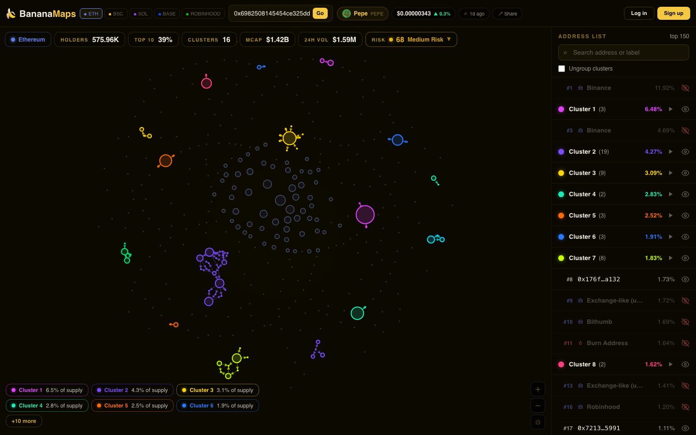
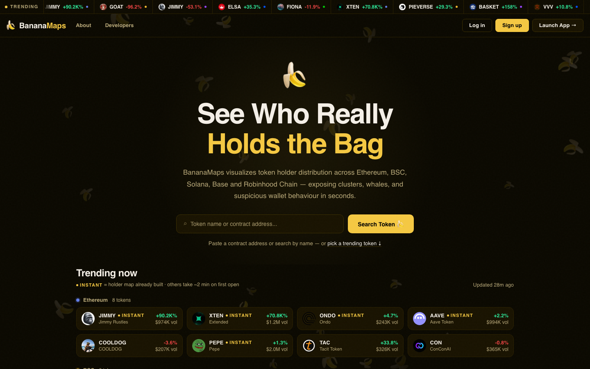
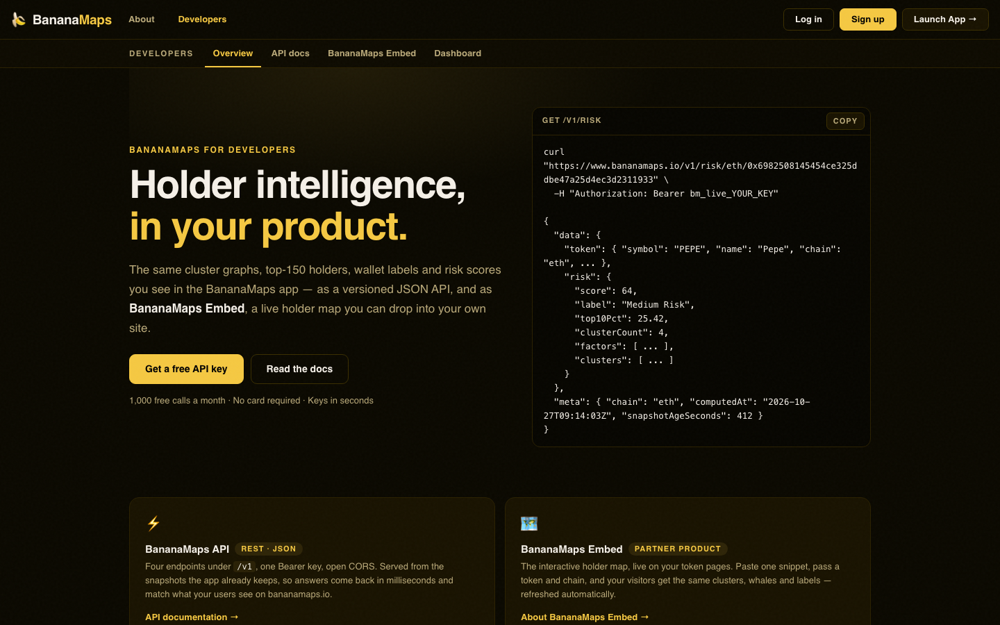

# 🍌 BananaMaps

**See who really holds a crypto token.** BananaMaps turns a token's top holders into an interactive bubble map. It groups wallets that have moved the token between each other into clusters, labels exchange and contract wallets, and gives each token a 0–100 holder-concentration risk score.

**Live app:** [www.bananamaps.io](https://www.bananamaps.io) · **Developer API:** [www.bananamaps.io/developers](https://www.bananamaps.io/developers)



---

## The problem

Before buying a newer crypto token, people want to know whether a small group secretly controls most of the supply. Block explorers list the top holders, but they don't show that ten "separate" wallets have all been funded by the same source. Spotting that by hand means clicking through hundreds of transfers. BananaMaps does that work automatically and shows the result as a picture you can read in seconds.

## What it does

- **Holder bubble map.** Paste a contract address or search by name. BananaMaps loads the top 150 holders and their transfer history, then draws a force-directed map where bubble size is the share of supply held.
- **Cluster detection.** Wallets that transferred the token between each other are grouped into colour-coded clusters. Each cluster shows its combined share of supply.
- **Wallet labels.** Exchange, DEX, burn and contract wallets are identified and kept out of clusters. Labels come from a curated list, a label cache, provider APIs and on-chain contract checks. An unlabelled wallet linked to six or more holders is flagged as "Exchange-like (unverified)" so it doesn't create a false giant cluster.
- **Risk score (0–100).** A weighted score built from five factors, with exchange wallets removed first:
  - the largest wallet's share of supply
  - the top 10 wallets' combined share
  - how many clusters were found
  - how many holders were mapped
  - how the top 5 holdings compare with the bottom half

  Scores are banded as Low, Medium, High or Very High risk, and the app shows the full breakdown.
- **Five chains:** Ethereum, BNB Chain, Base, Solana and Robinhood Chain.
- **Trending homepage.** A ticker and a grid of trending tokens per chain. Tokens whose map is already built are marked **Instant**.
- **Public REST API (v1).** Four read-only endpoints, `graph`, `holders`, `labels` and `risk`, each called as `/v1/{endpoint}/{chain}/{address}`. They use Bearer API keys (only a SHA-256 hash of each key is stored) and send rate-limit and quota headers.
- **Developer portal.** Sign up, create and revoke API keys, choose a plan, and manage embed partners. Billing runs through Stripe Checkout and the Stripe customer portal.
- **BananaMaps Embed.** A lightweight map that other sites can put on their own token pages in an iframe.
- **Accounts.** Supabase email/password authentication with signup, login, password reset and email confirmation.
- **Share images.** Each token gets its own Open Graph preview image for link sharing.

| Homepage | Developer portal |
|---|---|
|  |  |

## How it works

```
                     ┌──────────────────────────────┐
  Browser ──────────▶│  Next.js app on Vercel       │
  (map, portal,      │  pages · /api/graph · /v1/*  │
   embed, API)       └──────────────┬───────────────┘
                                    │ reads snapshots / requests a build
                                    ▼
                     ┌──────────────────────────────┐
                     │  Supabase (Postgres + Auth)  │◀──── Stripe webhooks
                     │  graph snapshots · labels ·  │      (billing events)
                     │  API keys · usage · registry │
                     └──────────────▲───────────────┘
                                    │ writes fresh snapshots
                     ┌──────────────┴───────────────┐
                     │  Background worker (Node,    │──▶ Moralis · Helius · Vybe ·
                     │  pm2 on a VPS)               │    DexScreener · GeckoTerminal ·
                     │  incremental sync + rebuilds │    public JSON-RPC nodes
                     └──────────────────────────────┘
```

1. **Data collection.** Each chain uses different providers:
   - **EVM chains:** holders and transfers come from Moralis.
   - **Solana:** holders come from Vybe (falling back to a Helius scan) and transfers from Helius.
   - **Robinhood Chain:** none of those providers cover it, so BananaMaps rebuilds balances by replaying the token's ERC-20 `Transfer` logs over JSON-RPC.
2. **Graph building.** A shared, network-free module (`lib/graphCore.ts`) builds the graph. It counts transfer edges, removing duplicates by transaction id, finds clusters with union-find, and keeps labelled wallets out of clusters. The same module is used by both the web app and the worker, so their results match.
3. **Background indexing.** A separate worker (`worker/`) keeps a registry of tokens. It ranks each token hot, warm or cold by liquidity and volume, and syncs it every 10 minutes, hourly or daily to match. It enforces daily per-provider budgets, pauses a failing provider with a circuit breaker, and backs off on tokens that keep failing. See [worker/README.md](worker/README.md) for the full design.
4. **Serving.** Visitors and API calls read the stored snapshots, so the site stays fast and provider costs stay predictable. If a token hasn't been mapped yet, the app builds it on demand, with per-IP and daily limits.
5. **Billing and API access.** A single Postgres function, `api_authorize()`, checks the key, the monthly quota and the per-minute rate limit, and records the call, all in one step. Stripe webhooks keep plan status in sync and record event ids so the same event is never processed twice.

## Tech stack

| Area | Technology |
|---|---|
| Web app | Next.js 16 (App Router), React 19, TypeScript, Tailwind CSS 4 |
| Visualization | d3-force layout rendered on HTML canvas |
| Database & auth | Supabase (Postgres, Row Level Security, Auth) |
| Payments | Stripe (Checkout, customer portal, webhooks) |
| Blockchain data | Moralis, Helius, Vybe, Solscan, DexScreener, GeckoTerminal, PublicNode RPC, Robinhood Chain RPC |
| Background worker | Node.js + TypeScript, run with pm2 on a Linux VPS |
| Hosting | Vercel (app + daily cron), VPS (worker) |

## Technical challenges and solutions

These are drawn from the code and commit history.

- **A chain with no indexer support.** Robinhood Chain's explorer API sits behind a bot challenge, and the main data providers don't cover the chain.
  - *Solution:* rebuild holder balances by replaying `Transfer` event logs from the chain itself, in block ranges that resize to the amount of data, with a capped balance ledger.
  - Very large tokens are handed to the background worker, and the browser polls until the map is ready (`lib/robinhoodRpc.ts`).
- **Public RPC rate limits.** The public Robinhood RPC returns HTTP 429 at roughly 4–5 requests per second.
  - *Solution:* adaptive pacing that widens the gap between calls after each 429 and tightens it again after successes.
  - Also: exponential retry delays, batched requests, and failover across an ordered list of endpoints.
- **Keeping API costs under control.** Building one map can take hundreds of provider calls.
  - *Solution:* a build guard (per-IP limits, a concurrency cap, daily caps per chain), request sharing so simultaneous requests for the same token trigger only one build, and per-provider metering that feeds the worker's daily budgets (`lib/buildGuard.ts`, `lib/buildRunner.ts`, `lib/providerMeter.ts`).
- **Database write security.** The first version let the public (anon) key write to the cache tables.
  - *Solution:* a later migration removed those write rules and moved all server writes to the service-role key (`supabase/migrations/20260714_lock_cache_writes.sql`).
- **Exchanges distorting clusters.** Exchange hot wallets touch thousands of holders and would merge unrelated wallets into one false cluster.
  - *Solution:* labelled wallets never join or connect clusters, and the "hub" rule flags unlabelled exchange-like wallets.
- **Long builds inside iframes.** An embedded map can't keep a request open for one to three minutes.
  - *Solution:* the graph endpoint returns `202 Accepted` right away and the embed polls the cache until the snapshot is ready.
- **Provider changes.** When a provider's Solana top-holders endpoint stopped working, holder data was switched to Vybe, with a Helius fallback.

## How I built this

I built BananaMaps using **AI-assisted development with Claude Code**. My role was:

- leading the product concept and defining the requirements
- testing the app with real tokens on every supported chain
- debugging issues found in production
- deploying and operating it on Vercel, Supabase and a VPS-hosted worker

Claude Code generated most of the code under my direction. The project grew over 130+ commits between March and October 2026, from a first working bubble map to a multi-chain product with a background indexer, a paid API and embeddable maps.

## Running locally

```bash
cp .env.example .env.local   # add Supabase, provider and Stripe keys
npm install
npm run dev                  # http://localhost:3000
```

The required environment variables are listed in [`.env.example`](.env.example): Supabase URL and keys, `MORALIS_API_KEY`, `HELIUS_API_KEY`, `VYBE_API_KEY`, `SOLSCAN_API_KEY`, the Stripe keys and `CRON_SECRET`. Database tables are created by the SQL files in [`supabase/migrations/`](supabase/migrations). Setup for the background worker is in [worker/README.md](worker/README.md).

## Disclaimer

BananaMaps shows on-chain data and a rule-based concentration score. It is not financial advice.
